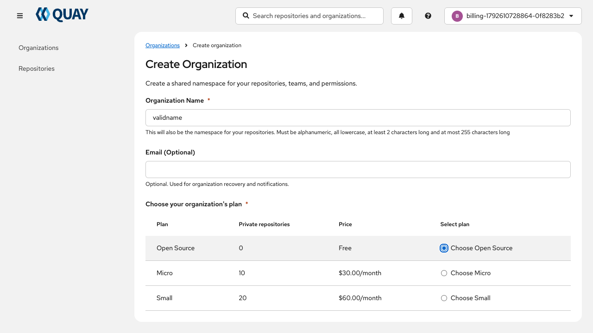
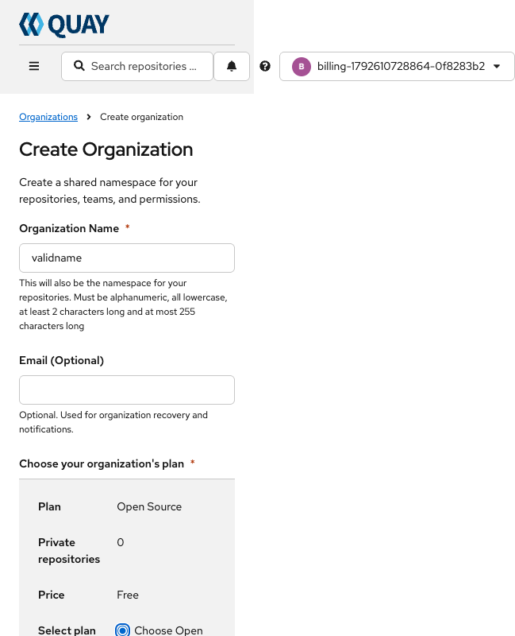
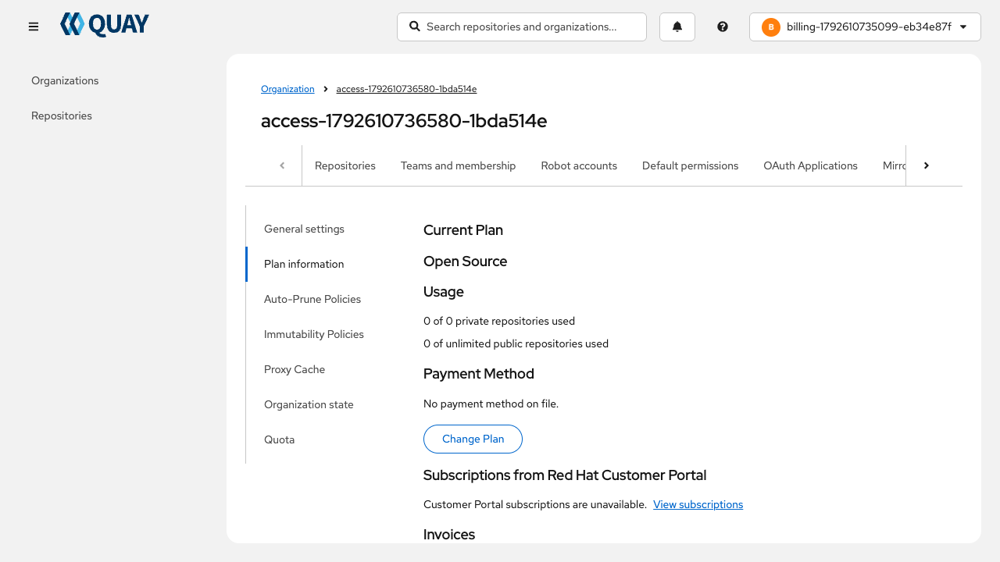
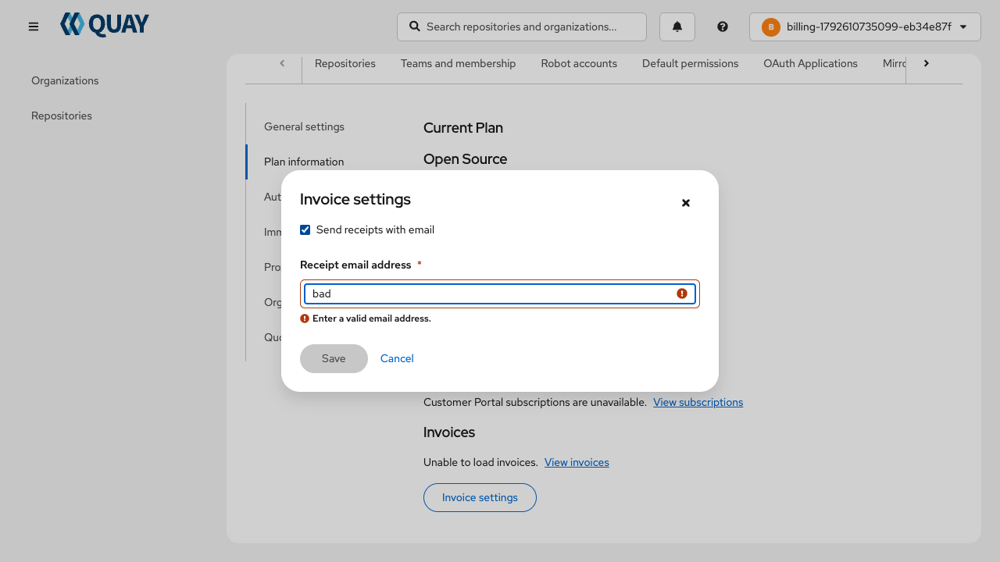
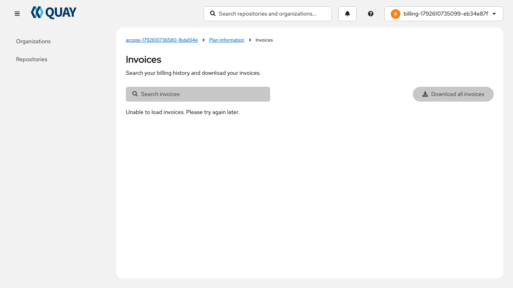
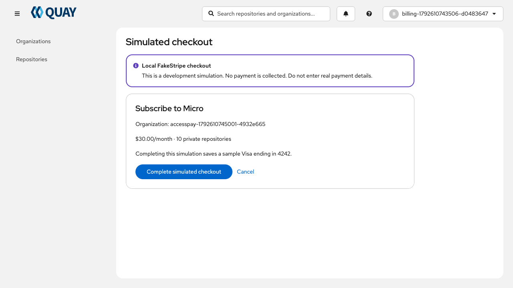
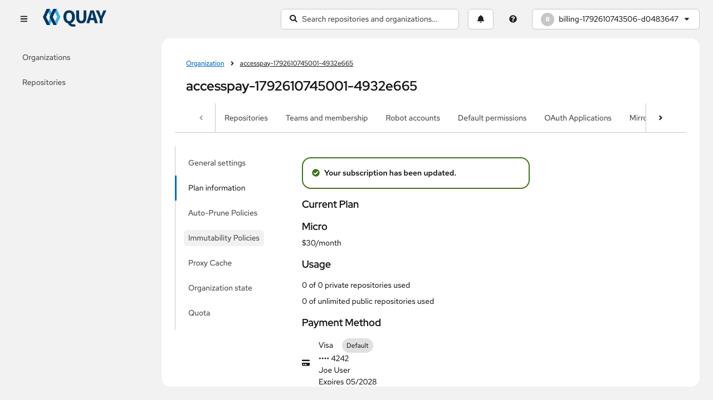
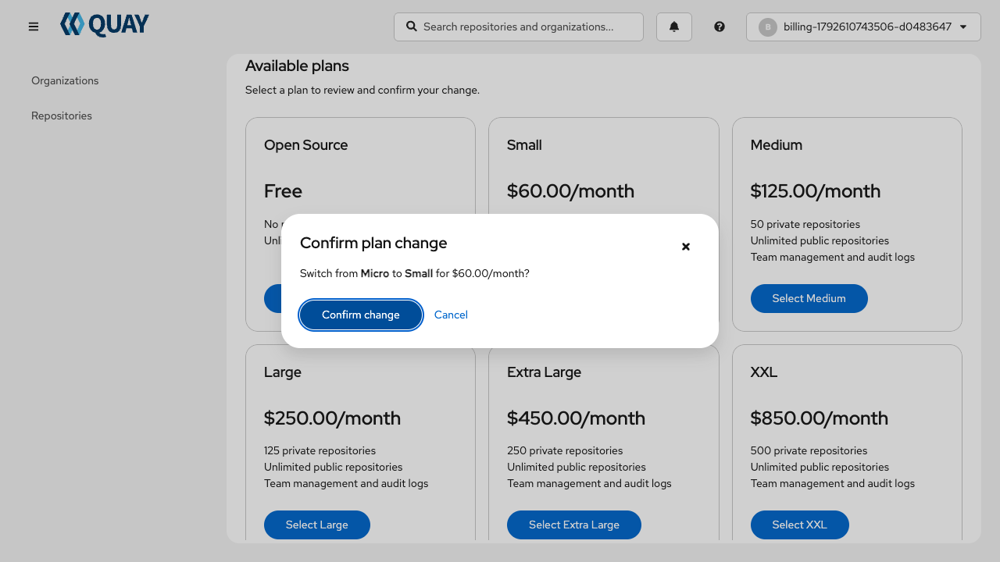

# Billing and organization creation accessibility review

Review date: 2026-10-21. Baseline: `0aa9746dc..d66650950` on `Plan-info`. Target: WCAG 2.2 Level AA. Original findings below preserve the reviewed baseline. The remediation recheck records the current implementation and evidence separately.

## Remediation recheck

Rechecked source in the isolated PR worktree `/private/tmp/quay-billing-review` after the coordinating agent's fixes, then inspected all eight screenshots from the final real-backend Playwright run. This recheck made no implementation or test changes. The five retained-feature deficiencies are resolved in source; their rendered coverage and limitations are recorded below. This is not a whole-product WCAG conformance statement.

| Finding | Source recheck status | Remaining verification |
| --- | --- | --- |
| A11Y-01: status announcements | Resolved in source: creation/checkout failure, organization-created success, polling/result, payment, plan confirmation errors and Customer Portal mutation alerts now use PF6 live-region semantics. Organization success was corrected after the recheck identified the remaining equivalent path. | Rendered live semantics passed for invalid fake session, confirmed/unconfirmed plan results, creation success and name-conflict errors. Unavailable-provider retry scenarios were conditionally skipped because FakeStripe works. Real screen-reader speech/announcement duplication remains unverified. |
| A11Y-02: field help/errors | Resolved in source: stable helper IDs and `aria-describedby` supplied for name, optional email and receipt email; structured HelperText error styling and live semantics added. | Passed real-backend accessible-description and invalid-state assertions; receipt settings save/reload also passed. Actual speech behavior remains unverified. |
| A11Y-03: plan radio group | Resolved in source: PF6 FormGroup has `role="radiogroup"`, generated visible label association and `aria-required="true"`. | Passed required group/name, native arrow/Space selection, feature-scoped axe scans at desktop and 320px, and feature container right-edge check. Whole-document narrow-screen overflow remains an inherited shell issue. |
| A11Y-04: control names | Resolved in source: NumberInput internal ID, Quantity name and contextual increment/decrement labels; invoice links named “Download PDF for invoice …”. | Source-only for quantity and per-invoice download names: no local Customer Portal SKU entitlement and invoice backend returned an error/no rows. The invoice-page error state was scanned. |
| A11Y-05: prototype defects | Resolved by scope removal: imitation StripeCheckoutPreview, its custom CSS/assets and unused PaymentMethodDialog removed. Actual PF6 FakeCheckout remains clearly labeled as local simulation. | Confirm production/mock builds have no remaining prototype route or missing imports. No claim about external Stripe-hosted checkout. |
| A11Y-06: progress bounds | Resolved in source: shared usage helper clamps the percentage; Progress receives exact usage `valueText` and over-limit warning; helper tests cover normal, over-limit, zero allowance and unlimited cases. | Record unit test outcome and inspect rendered progress on a namespace with actual nonzero allowance when available. |

The active Settings tab now supplies `tabContentId` and an external PF6 TabContent with the corresponding ID and label association. Real-backend Playwright verified the active Plan information tab/panel relationship. The new [accessibility spec](../../web/playwright/e2e/billing/accessibility.spec.ts) passed all four tests: invalid simulated-session announcement; organization descriptions/validation/radio keyboard selection; billing panel/invoice dialog validation and full Tab/Shift+Tab containment cycles, Escape, focus restoration and settings persistence; and FakeCheckout/result announcement plus keyboard operation of the existing-subscription confirmation dialog. Feature-scoped axe scans using `@axe-core/playwright` 4.14.0 reported no violations with WCAG 2 A/AA, 2.1 AA and 2.2 AA tags in the tested states.

Verified the final browser log: **17 passed, 2 conditionally skipped**, including the four accessibility tests. The skipped tests require an unavailable checkout provider; enabling those scenarios would conflict with the functioning FakeStripe provider used for this run. Additional organization/email/CRUD/success-alert regressions passed **11 tests**. The coordinating agent also ran the actual billing-disabled configuration (**5 passed**) and restored it afterward. Exact commands and broader build/unit/backend results belong in the consolidated test report; these counts do not mean every possible accessibility state was exercised.

Earlier attempts are not counted as final passes: the initial receipt-description assertion was too exact for PF6's intentional additional “error status” text and was corrected to match the meaningful description. A transient contrast reading of 1.69:1 occurred during PF6 fade-in; scanning now awaits finite animations before checking stable rendered colors, and final scans passed. This timing adjustment does not suppress contrast rules or waive a lasting contrast failure. The initial whole-document 320px check found width 644; DOM inspection attributed overflow to the inherited header action group and off-canvas drawer. The feature container right edge is at most 321px in the final check. Whole-page reflow remains unverified/failing at this width and is not claimed as fixed by the feature.

## Verdict and method

The feature uses native buttons, labeled PatternFly inputs, semantic tables, named dialogs, and explicit plan choices. Full-page organization creation and same-window checkout preserve the requested interaction model. Source review found five feature deficiencies that should be corrected before PR review: unannounced asynchronous outcomes, unassociated field help/errors, missing plan-group semantics, accessible names that differ from visible labels, and invalid progress values when usage exceeds the allowance. A separate development-only preview has additional deficiencies. Existing shell/tab issues are distinguished below.

Reviewed the entire changed frontend surface: organization creation and toolbar navigation; plan information, usage and payment summaries; change-plan cards and confirmation; invoice list/search/settings; Customer Portal subscriptions and attachment/removal; local simulated checkout; prototype checkout and the unused saved-payment dialog; standalone/plugin route integration. Read the root, frontend, and Playwright instructions. Inspected the installed PF6 implementations of Alert, FormGroup, NumberInput, and Tabs to verify their actual defaults rather than assuming the component supplied missing semantics.

Supported browser connection was attempted during this run. In-app Browser was unavailable; the available Chrome connection failed before tab access with `unsupported Codex auth method: apikey`. The coordinating agent used the user-approved Playwright workflow for fresh real-backend DOM, keyboard and screenshot evidence. This review agent read the final logs and inspected the saved images. No browser accounts, organizations, or billing settings were changed by this review agent; the automated workflow used disposable accounts and real API cleanup.

## Findings and remediation

### A11Y-01 — High: asynchronous checkout and creation outcomes are not announced

- **Criteria:** WCAG 4.1.3 Status Messages (AA); error cases also affect discovery of the textual errors required by 3.3.1.
- **Locations:** `web/src/routes/OrganizationsList/CreateOrganization.tsx:136`; `web/src/routes/OrganizationsList/Organization/Tabs/Settings/ChangePlan.tsx:173` and `:268`; `web/src/routes/OrganizationsList/Organization/Tabs/Settings/BillingInformation.tsx:154` and `:204`; `web/src/routes/OrganizationsList/Organization/Tabs/Settings/FakeCheckout.tsx:90`; `web/src/components/modals/OrgSubscriptionModal.tsx:71`; `web/src/routes/OrganizationsList/Organization/Organization.tsx:238`.
- **Evidence/reproduction:** Trigger a checkout/organization creation failure or return with an unconfirmed plan and wait for polling to finish. The visible error/result appears or changes while focus remains elsewhere. These inline Alerts do not pass `isLiveRegion`, an appropriate role, or move focus to the result. The installed PF6 Alert renders a plain `div`, defaults `isLiveRegion` to `false`, and adds `aria-live` only when requested. Global `Alerts` uses a live AlertGroup, but these inline Alerts are siblings outside that group. The existing InvoiceSettingsModal server error explicitly sets `aria-live="polite"`; preserve that working behavior.
- **Recommended fix:** Use a stable, scoped polite status/live container for asynchronous outcomes; use PF6 `isLiveRegion` or an equivalent role/announcement strategy as appropriate. For submitted-form failure, consider focusing an error summary with a descriptive title and links to actionable fields. Announce the final polling result once; do not repeatedly announce unchanged content during every refresh. Apply the same rule to equivalent feature-specific error paths.
- **Acceptance:** Playwright verifies that completion, cancellation/result, unavailable checkout, retry failure, and subscription mutation failure expose live semantics or a deliberately focused error summary. Verify in a screen reader that the final result is heard without moving focus, without duplicate repeated announcements. Keep Retry checkout and Go to organization keyboard reachable after a paid creation failure.

### A11Y-02 — Medium: form instructions and errors are not associated with their inputs

- **Criteria:** WCAG 1.3.1 Info and Relationships (A); dynamic validation also relates to 4.1.3 Status Messages (AA). Textual errors exist, so this is not a claim that all visible validation fails 3.3.1.
- **Locations:** `web/src/routes/OrganizationsList/CreateOrganization.tsx:167`–`:212`; `web/src/routes/OrganizationsList/Organization/Tabs/Settings/InvoiceSettingsModal.tsx:115`–`:129`.
- **Evidence/reproduction:** Focus organization name/email or receipt email, then type an invalid value and blur as applicable. The helper/error text has no stable ID referenced by the input's `aria-describedby`; PF6 FormGroup does not automatically create this association. The organization helper text changes without a live-region strategy. Receipt email uses a raw FormHelperText string, losing structured HelperText error/status semantics.
- **Recommended fix:** Assign stable helper IDs and reference them from the corresponding inputs. Use HelperText/HelperTextItem and an appropriate error variant. Announce dynamic validation at useful interaction boundaries rather than every keystroke if that becomes noisy. Preserve `aria-invalid` from PF6 validation.
- **Acceptance:** Input accessible descriptions contain the applicable naming rule, optional-email guidance, or valid-email error; referenced IDs resolve uniquely. Invalid email and name remain editable; controls expose invalid state and errors are available without searching unrelated page content. Valid corrections clear stale invalid state and descriptions update.

### A11Y-03 — Medium: organization plan selection lacks its visible group label and required state

- **Criteria:** WCAG 1.3.1 Info and Relationships (A), 4.1.2 Name, Role, Value (A).
- **Location:** `web/src/routes/OrganizationsList/CreateOrganization.tsx:214`–`:282`.
- **Evidence/reproduction:** The visible required label “Choose your organization's plan” is generated as a `label for="organization-plan-selection"`, but that ID belongs to the table, which is not a labelable form control. The radios share a native name and each has a useful individual label, but there is no named group corresponding to the visible requirement. The required asterisk is hidden from assistive technologies and no group-level required state is supplied.
- **Recommended fix:** Use the PF6 FormGroup `role="radiogroup"` behavior (which generates an associated legend) or a native fieldset/legend; expose the required state appropriately. Retain the actual table semantics and distinct radio labels, and keep the group label associated with its radios even when stacked on narrow screens.
- **Acceptance:** Accessibility queries find one required radio group with the visible plan-selection name and all available plans inside it. Keyboard Tab enters the group; arrow keys change plans; Space selects; the next Tab reaches the next meaningful action. Prices/repository limits remain readable in table navigation and after responsive stacking.

### A11Y-04 — Medium: names override visible labels in quantity and invoice controls

- **Criteria:** WCAG 2.5.3 Label in Name (A); quantity also 1.3.1 Info and Relationships (A).
- **Locations:** `web/src/components/modals/OrgSubscriptionModal.tsx:120`–`:140`; `web/src/routes/OrganizationsList/Organization/Tabs/Settings/InvoiceList.tsx:152`.
- **Evidence/reproduction:** For SKU MW02702 attachment, NumberInput receives an `id` on its wrapper, while the internal input receives the PF6 default `aria-label="Input"`. The visible Quantity label therefore neither targets the real input nor appears in its name. Invoice links visibly say “Download PDF” but the name is overridden to “Download invoice [id] as PDF”, omitting the visible wording as a contiguous label.
- **Recommended fix:** Give the internal NumberInput input its ID through `inputProps`, set a name that contains Quantity, and use contextual increment/decrement names. Name each invoice action “Download PDF for invoice [id]” or retain visible text with additional screen-reader context. Update existing tests that assert old names.
- **Acceptance:** Quantity can be located by its visible label; internal input ID resolves and bounds are exposed. Increment/decrement controls have clear names. Every invoice link's accessible name contains “Download PDF” and its unique invoice identifier; download behavior still works.

### A11Y-05 — Medium, development-only: prototype checkout label, error and contrast defects

- **Criteria:** WCAG 2.5.3 Label in Name (A), 1.4.3 Contrast Minimum (AA), 1.3.1 Info and Relationships (A), 4.1.3 Status Messages (AA).
- **Locations:** `web/src/routes/OrganizationsList/Organization/Tabs/Settings/StripeCheckoutPreview.tsx:138`, `:231`, `:415`, `:461`; `web/src/routes/OrganizationsList/Organization/Tabs/Settings/StripeCheckoutPreview.css:373` and `:422`; unused `PaymentMethodDialog.tsx:75`.
- **Evidence:** The merchant link visibly says “Red Hat, Inc” but is named “Back to Plan information”; the card-number input overrides visible “Card information” with “Card number”. Preview validation is presented in a non-live summary with no field association. CSS defines normal 11px terms text as #858585 on white (3.69:1) and sample-checkout footer as #888 on white (3.54:1), below the normal-text 4.5:1 threshold. These ratios are source-based calculations; computed rendered color/opacity has not been independently checked by this agent. Saved-payment dialog errors similarly lack live semantics.
- **Scope:** StripeCheckoutPreview is reachable only when `MOCK_API === 'true'` and `prototypeCheckout=1` in StandaloneMain. PaymentMethodDialog currently has no call site. These are not claims about the external Stripe-hosted checkout. FakeCheckout is a separate local simulation and is covered by A11Y-01.
- **Recommended fix:** If prototypes remain in the upstream change, fix their labels, validation announcements/association and text tokens; verify computed contrast. If they are removed from PR scope, record removal and exclude those paths from conformance claims rather than implementing unrelated prototype polish.
- **Acceptance:** Retained prototype controls include visible wording in their names; errors are announced and linked to the relevant input; rendered normal text reaches at least 4.5:1. Dead dialogs are removed or explicitly excluded from the deployed surface.

### A11Y-06 — Medium: over-limit repository usage exposes an invalid progress value

- **Criterion:** WCAG 4.1.2 Name, Role, Value (A).
- **Location:** `web/src/routes/OrganizationsList/Organization/Tabs/Settings/UsageSection.tsx:31`–`:43`.
- **Evidence/reproduction:** The value is `(privateCount / totalPrivate) * 100`, which exceeds 100 when an organization has more private repositories than its plan allows. The installed PF6 Progress clamps only its visual scaled value; it puts the original value into `aria-valuenow`, with default `aria-valuemax=100`. For 15 used of 10 allowed, assistive technology receives value 150 with maximum 100.
- **Recommended fix:** Clamp the numeric percentage into the exposed bounds and pass explicit `valueText` with the actual count and allowance, including the over-limit condition. Preserve accurate visible usage instead of hiding the excess.
- **Acceptance:** Normal, zero-allowance, unlimited, and over-limit cases have valid ARIA bounds; over-limit progress exposes `aria-valuenow <= aria-valuemax` and descriptive text such as “15 of 10 private repositories used”. The visual and spoken summaries still communicate excess usage. This finding was independently confirmed in source and also identified by the PF6 review agent.

## Inherited issues and additional risks

- **Settings tab association — resolved for active panel:** The baseline rendered empty Tab children and unrelated active content. The touched integration now supplies a matching external TabContent ID and label. The active Plan information `aria-controls` relationship passed rendered assertions. No broader settings redesign was performed.
- **Inherited shell overflow — still open:** At 320 CSS pixels, the unchanged header action group and off-canvas drawer increase document width beyond the viewport. Screenshot 02 deliberately captures that wider document. The organization form/table reflows inside the viewport and its right-edge geometry check passed; this does not establish whole-page SC 1.4.10 conformance. Track shell reflow separately rather than hiding the overflow with a document-wide clip.
- **Route focus:** New standalone pages do not explicitly focus the new heading/main region when React Router replaces the prior view. Neither inspected shell supplies a feature route focus manager. Rendered keyboard testing must establish whether focus is lost to body or restarted in shell navigation before classifying this as a confirmed 2.4.3 defect. A scoped heading focus strategy would improve orientation; do not add a global focus change without checking plugin behavior.
- **Document titles:** Shell titles currently describe the application, not individual new views. W3C allows an application name as a title in some applications, so this is a possible orientation improvement rather than a definite 2.4.2 failure from source alone.
- **Loading:** New FakeCheckout and organization plan Skeletons have screen-reader text. Existing summary component Skeletons lack text/live state; verify whether the surrounding page announces loading adequately before adding noisy repeated live regions.

## Flow evidence and rendered verification matrix

The coordinating agent captured these screenshots in the final run, and this review agent opened and inspected all eight saved files. They are stable intended states, with explicitly labeled backend and shell limitations. Images show the actual current viewport/internal scrolling position; they do not claim every lower section fits onscreen at once.

| Step | Surface and state | Assessment | Rendered status |
| --- | --- | --- | --- |
| 1 | Organizations list → Create Organization | Healthy: full-page route, no creation modal | Route/catalog regression passed; screenshot 01 |
| 2 | Create Organization, name/email validation and plan table | Feature fixes passed; whole-page reflow remains limited by shell | Descriptions, invalid states, named required group, keyboard arrows/Space, desktop/320px scoped axe and feature right-edge check passed; screenshots 01–02 |
| 3 | Paid creation failure and retry | Source fix retained; unavailable-provider scenario not exercised | Conditional retry test skipped; working-provider creation/checkout flows passed; name-conflict live-error and field-retention regression passed |
| 4 | Local simulated checkout and cancel/complete | Healthy within tested simulation | Fake session-error live semantics, scoped axe, same-window completion/cancellation and persisted plan passed; screenshot 06 |
| 5 | Plan information, returned and canceled states | Healthy tested status semantics | Confirmed/unconfirmed live results and cancellation states passed; screenshot 03 free plan and 07 confirmed paid plan; no whole-page mobile claim |
| 6 | Available plans and change confirmation | Healthy tested dialog interaction | Keyboard Enter opened dialog; focus entry, retained focus after Tab, Escape, trigger restoration and confirmed real API PUT change passed; screenshot 08. Full-cycle containment was separately exercised on invoice dialog. |
| 7 | Invoice list/settings | Settings healthy; invoice backend limitation visible | Active panel semantics, receipt helper/error, disabled invalid Save, full Tab/Shift+Tab containment, Escape/trigger return, save/reload persistence and scoped axe passed; screenshots 04–05. No real PDF rows available. |
| 8 | Customer Portal subscriptions and quantity modal | Source fixes verified; rendered entitlement controls unverified | Local Customer Portal unavailable, so quantity names/entitlement-specific controls remain source-only |
| 9 | Development-only checkout preview | Removed | Imitation preview/custom assets/unused saved-payment dialog removed; no external Stripe conformance claim |

### Accepted screenshots in flow order

1. **Organization creation, desktop — healthy feature state.** Native fields and explicit plan radio selection are visible; helper/name/keyboard assertions passed.

2. **Organization creation at 320px — feature reflows; inherited shell overflow remains.** The full-page capture is wider than 320px because it deliberately includes the overflowing header actions. Do not interpret the image width as the simulated viewport width or claim whole-page reflow passed.

3. **Plan information, free organization — healthy tested billing-panel association.** Customer Portal is unavailable locally; the visible summary records that limitation.

4. **Invoice validation dialog — healthy error and focus state.** A textual error, invalid input and disabled Save are visible; accessible description and focus containment/restoration assertions passed.

5. **Invoice list — backend-limited error state.** This is accepted as evidence of the observed error surface, not of a successful invoice/PDF flow. No per-invoice download names were rendered for verification.

6. **Simulated checkout — healthy local simulation state.** The notice distinguishes it from real payment collection; scoped axe scan passed.

7. **Confirmed subscription — healthy result state.** API-backed confirmation and live-region semantics passed; screenshot includes the sample stored card.

8. **Existing subscription plan confirmation — healthy tested dialog state.** Selected plan/price are reviewable before the real local API update; focus entry/Escape/return and confirmation behavior passed.

No conclusion is made for actual VoiceOver/NVDA speech, 200% text resizing, real 400% browser zoom, forced-colors/high-contrast rendering, touch target spacing, all possible focus-obscuring states, authenticated native plugin runtime, or external Stripe-hosted checkout. Feature geometry at a 320px viewport is supporting reflow evidence, not the same as real browser zoom or enlarged OS text. Scoped axe passes exclude the surrounding shell and do not establish WCAG compliance of the whole page. Quantity and invoice-PDF names are source-verified only; backend entitlement/invoice data is required to verify those rendered controls. No real charge was made.

## Prioritized fix and verification plan

1. **Completed:** Correct A11Y-01–04/06 in the retained feature, remove A11Y-05 prototype code, and recheck source. Record actual test outcomes rather than treating assertions as passed before execution.
2. **Completed for local tested states:** Fresh screenshot inspection, feature-scoped axe scans, radio keyboard operation, active billing-tab association, invoice dialog focus cycles/Escape/return/persistence, local checkout and result semantics. Preserve the final tests and baseline findings in this report.
3. **Before claiming deployed accessibility coverage:** Test authenticated native Quay.io/plugin integration and Stripe test-mode checkout in an authorized deployed environment. Use real entitlement/invoice data to verify quantity names and PDF actions; rerun unavailable-provider retry scenarios in a suitable configuration.
4. **Manual follow-up:** Use VoiceOver/NVDA to hear form instructions, validation, polling and checkout outcomes; verify no noisy repeated announcements. Test real 200% text resizing, 400% zoom, forced colors and focused-control visibility through complete flows.
5. **Separate inherited follow-up:** Track the narrow-screen shell header/drawer overflow and route-orientation behavior without claiming feature tests fixed the entire shell. Include this limitation and any deployment blockers in the PR; open draft status if required integration checks remain unavailable.

## Primary references

- [WCAG 2.2 Status Messages](https://www.w3.org/WAI/WCAG22/Understanding/status-messages.html) and [PatternFly Alert accessibility](https://www.patternfly.org/components/alert/accessibility/) support explicit announcement of asynchronous status updates.
- [WCAG Info and Relationships](https://www.w3.org/WAI/WCAG22/Understanding/info-and-relationships.html), [Error Identification](https://www.w3.org/WAI/WCAG22/Understanding/error-identification.html), and [PatternFly Helper Text accessibility](https://www.patternfly.org/components/helper-text/accessibility/) support field guidance/error associations.
- [WCAG Name, Role, Value](https://www.w3.org/WAI/WCAG22/Understanding/name-role-value.html), [Label in Name](https://www.w3.org/WAI/WCAG22/Understanding/label-in-name.html), and [PatternFly Radio accessibility](https://www.patternfly.org/components/forms/radio/accessibility/) support named groups and matching control labels.
- [WCAG Contrast Minimum](https://www.w3.org/WAI/WCAG22/Understanding/contrast-minimum.html) defines normal-text contrast requirements.
- [WAI-ARIA modal dialog pattern](https://www.w3.org/WAI/ARIA/apg/patterns/dialog-modal/), [Focus Order](https://www.w3.org/WAI/WCAG22/Understanding/focus-order.html), [Focus Not Obscured](https://www.w3.org/WAI/WCAG22/Understanding/focus-not-obscured-minimum.html), [Target Size Minimum](https://www.w3.org/WAI/WCAG22/Understanding/target-size-minimum.html), and [Reflow](https://www.w3.org/WAI/WCAG22/Understanding/reflow.html) inform the outstanding rendered checks.

Official documentation was checked during this run. PatternFly's public documentation may display a newer release; implementation-specific conclusions were checked against the locally installed PF6 source. A complete accessibility conformance statement additionally requires the deployed product, supported assistive-technology/browser combinations, and external checkout to be tested; this review does not certify those environments.
